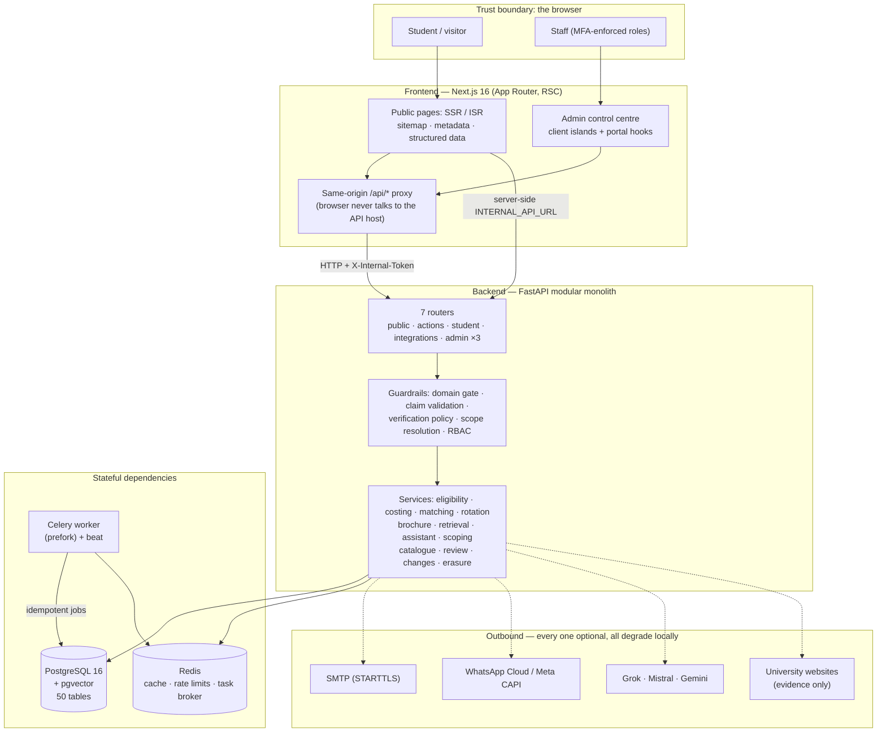

# Scholara

**Global Education Intelligence & Application Platform**
for an international education consultancy based in Uttara, Dhaka.

Scholara is a single-organisation platform (not a SaaS, not multi-tenant) that gives Bangladeshi
students a *verifiable* way to research studying abroad — universities, programmes, requirements,
intakes, real annual costs, scholarships and PhD supervisors — and gives the consultancy a CMS, a
CRM pipeline and a marketing/ads control centre behind it.

The product's organising principle: **every student-facing fact carries its source, its source
type, the date it was retrieved, the date it was verified and a confidence state.** The platform
never invents a university fact, never produces a fake "95% admission chance", and never guesses a
professor's email address.

---

## What is in this repository

| Path | What it is |
| --- | --- |
| `backend/` | FastAPI + SQLAlchemy modular monolith. 50 application tables under Alembic (51 with `alembic_version`), seven routers, eligibility / costing / matching / rotation / brochure / retrieval / assistant / WhatsApp services, 1,185 tests on SQLite (50 skipped) and 1,235 on PostgreSQL with Redis required (nothing skipped). |
| `frontend/` | Next.js 16.3 (App Router, React 19, TypeScript, Tailwind v4). Public site + admin control centre. 93 source files, 99 tests. |
| `docs/` | The written deliverables — requirements, data model, API reference, data-integrity policy, SEO/ads playbook, admin guide, deployment runbook, workstream records. **Local only: excluded from version control and never published.** |
| `scripts/` | `stack.sh` (full PostgreSQL/Redis/Celery stack), `dev.sh` (zero-infrastructure SQLite run), `smoke-test.sh` (40 routes), `verify-new.sh` (63 live assertions). |

### Where the written deliverables live

The long-form documents — requirements, data model, API reference, the data-integrity policy, the
admin guide, the deployment runbook and the workstream records — live in `docs/` **in this
working copy only**. That directory is deliberately excluded from version control and from
publication, so it will not appear on GitHub.

What is published is this file and [`ARCHITECTURE.md`](ARCHITECTURE.md). They carry the product
description, the technology stack, the commands, the environment-variable names and the system
architecture on their own; nothing published here depends on reading `docs/`.

## How it fits together



**Trust boundaries.** The browser is outside every boundary: it holds an `HttpOnly` session cookie
and talks only to the Next.js origin, which proxies to the API. Staff routes require a role and,
for privileged roles, MFA. Catalogue facts are only published when a named human has verified
them — the assistant, the tools and the serializers all read through that policy, and scope
resolution fails closed.

**Where this is deployed.** The three tiers are what the code supports: SQLite + in-process cache
for a zero-setup local run; PostgreSQL + Redis + Celery for staging and production; Render for the
API, worker and beat, Vercel for the site, Supabase for PostgreSQL and Upstash for Redis. The
hosted configuration itself is **not** verified from this repository — service topology, worker
pool, backup settings and object storage are dashboard-side facts, and the last audit could not
read them.

---

## Running it locally

There are two supported ways to run this, and the application picks its backends from the
environment, so the only difference is which variables are set.

### The full stack (what the specification asks for)

PostgreSQL + pgvector, Redis, Celery, FastAPI and Next.js:

```bash
./scripts/stack.sh up       # start Postgres + Redis, migrate, seed, build the vector index
./scripts/stack.sh serve    # API + Celery worker + beat + website
./scripts/stack.sh status   # one screen: which backends are actually live
./scripts/stack.sh down
```

`status` is the quickest way to confirm what you are really connected to:

```
   database        127.0.0.1:5432/scholara
   is_postgres     True
   cache backend   redis
   celery          configured
   embeddings      local @ 1024 dims
   117/117 chunks carry a pgvector embedding
```

Use `pg_ctlcluster`, not `systemctl`, if you start PostgreSQL by hand — in containers
`policy-rc.d` blocks service starts and the systemctl error is misleading. `stack.sh` already
does this.

### The zero-infrastructure run

`./scripts/dev.sh` runs the same application on SQLite with an in-process cache and scheduler, no
services required. Everything works except the four things that need real infrastructure
(shared-state rate limiting, distributed task queue, pgvector ANN search, cross-process cache) —
each of which degrades to a working in-process equivalent rather than failing.

### Backend

```bash
cd backend
python3 -m venv .venv && source .venv/bin/activate
pip install -r requirements.txt
# Create backend/.env yourself from the variable names listed below.
# No template is published: every `.env*` file is excluded from this repository by policy,
# so a fresh clone intentionally contains none.
python -m alembic upgrade head  # build the schema (50 tables + alembic_version)
python -m app.seed              # populate data/scholara.db with the demo dataset
uvicorn app.main:app --host 0.0.0.0 --port 8000 --reload
```

API: `http://localhost:8000/api/v1` (131 paths / 140 operations) · OpenAPI:
`http://localhost:8000/api/openapi.json`

#### The AI assistant (optional)

The assistant runs without any API key, answering from deterministic templates built on verified
records. To switch on generated prose, set **any one** of these in `backend/.env` — they are
interchangeable and no code changes:

| Provider | Key | Get one from |
| --- | --- | --- |
| Grok (xAI) | `XAI_API_KEY` | [console.x.ai](https://console.x.ai) |
| Mistral AI | `MISTRAL_API_KEY` | [console.mistral.ai](https://console.mistral.ai) |
| Gemini | `GEMINI_API_KEY` | [aistudio.google.com/apikey](https://aistudio.google.com/apikey) |

They are tried in `LLM_PROVIDER_ORDER` (default `grok,mistral,gemini`) and the first that answers
wins; if one fails the next takes over. Verify a key at **Admin → Operations → AI providers**.
Full detail in the deployment runbook kept in the local `docs/` working copy (§6).

#### Database migrations

The schema is owned by Alembic, not by `create_all`. `alembic.ini` reads the URL from your settings
at runtime, so the same commands work against SQLite locally and PostgreSQL in production.

```bash
python -m alembic upgrade head                      # apply everything
python -m alembic downgrade base                    # tear back down
python -m alembic revision --autogenerate -m "msg"  # after editing app/models/*
python -m alembic current                           # where am I
```

When autogenerating, point `DATABASE_URL` at a **throwaway** file first. Running autogenerate
against an already-migrated `data/scholara.db` diffs against the live schema and produces an empty
revision. `env.py` sets `compare_type=True` and `render_as_batch=True` so SQLite handles column
alterations correctly.

### Frontend

```bash
cd frontend
npm install
npm run dev                     # http://localhost:3000
```

`frontend/.env.local` holds `INTERNAL_API_URL=http://127.0.0.1:8000`. Server components call the API
directly on that URL; **browser code always uses relative `/api/...`**, which `next.config.ts`
rewrites to the backend. That keeps the browser from ever needing to know the backend's address.

It also holds `INTERNAL_API_TOKEN`, which must match the backend's. A production build renders
every university, programme and scholarship page by calling the API — far more requests per
minute than the public rate limit allows — and this token exempts that first-party traffic.
Without it the limiter refuses pages mid-build and they are frozen as 404s. Run
`python3 scripts/check-prerender.py frontend` after any build to confirm no page was baked as an
error.

The exemption covers **reads only**. A request carrying the token is still throttled when it writes:
the token exists so the build can read, not so a holder can push conversions, leads or assistant
questions past the rules written for them.

### Tests and verification

What this section describes is **local**: the work is implemented in this tree and verified by the
suites below on developer hardware. It is not published, not deployed and not operationally
verified — `ARCHITECTURE.md` §12 lists what a repository cannot tell you about a hosted environment.

```bash
cd backend && python -m pytest          # 1,185 tests on SQLite (50 skipped: see below)
cd backend && python -m ruff check . && python -m mypy app scripts
cd frontend && npm test                 # 99 tests, node --test plus mounted jsdom lifecycle tests
cd frontend && npx tsc --noEmit         # type-check; `npm run build` needs a live API
```

A plain run uses a throwaway SQLite database. Row locks, `SKIP LOCKED`, unique-violation
re-evaluation and shared cache state do not exist there, so those tests skip rather than pretend.
To run them, point the suite at disposable services:

```bash
export SCHOLARA_TEST_DATABASE_URL='postgresql+psycopg://user:pw@127.0.0.1:5432/disposable'
export SCHOLARA_PG_URL="$SCHOLARA_TEST_DATABASE_URL"     # the concurrency suite
export SCHOLARA_REDIS_URL='redis://127.0.0.1:6379/0'     # the live cache suite
export SCHOLARA_REQUIRE_PG_TESTS=1 SCHOLARA_REQUIRE_REDIS_TESTS=1   # a skip becomes a failure
cd backend && python -m pytest          # 1,235 tests, nothing skipped
```

`SCHOLARA_REQUIRE_*` exists because a skipped test and a passing one look identical in a summary:
with the switch set, a missing URL is a usage error and any required test that skips fails the run.

### Continuous integration

`.github/workflows/ci.yml` runs five jobs on every push, every pull request and on demand, with
`permissions: contents: read`, no secrets, and every action pinned to a commit SHA:

| Job | What it proves |
| --- | --- |
| `backend-sqlite` | `ruff check .`, `mypy app scripts`, and the whole suite on the zero-setup engine — 1,185 passed, 50 skipped (the 41 PostgreSQL and 9 Redis tests), every skip named in the log and any other skip a failure |
| `backend-postgres` | a real PostgreSQL 16 + pgvector service and **two databases**: the migration database starts empty, has exactly one head (asserted to be `b4c5d6e7f8a9`), all seven recovered revisions are checked to still be in the chain, `upgrade head` builds the schema, pgvector and `knowledge_chunks.embedding_vec` are checked, the recovered tables, columns and unique indexes are asserted by name, exactly one `alembic_version` row, `downgrade a7b8c9d0e1f2` → `upgrade head` round-trips, and the app answers `/api/health/live` and `/api/health/ready` with PostgreSQL as its database; then the whole suite runs against the second database with `SCHOLARA_REQUIRE_PG_TESTS=1` (1,226 passed, only the 9 Redis tests skipped), and `tests/test_pg_concurrency.py` is additionally run on its own with a collected-count guard so a suite that is not discovered cannot pass |
| `backend-redis` | a real Redis 7 service: the `Cache` facade is proven Redis-backed and shared between two clients (set/get, `incr_with_ttl`, JSON round-trip, `invalidate_prefix`) rather than silently in-process, then the whole suite runs with `SCHOLARA_REQUIRE_REDIS_TESTS=1` (1,194 passed, only the 41 PostgreSQL tests skipped) and `tests/test_redis_live.py` is additionally run on its own with the same collected-count guard |
| `frontend` | `npm ci`, `npx tsc --noEmit`, and `npm test` — 99 tests, with the TAP pass/fail/skip counts asserted rather than trusting the exit code |
| `repository-policy` | `scripts/policy-check.py` on the tree, the index, the ignore rules and every commit of the change, plus two mutation tests: the guard must fail when a prohibited path is introduced, and the pytest gate must fail on a foreign skip or an empty run |

Three boundaries are deliberate. The backend suite is run **twice**, once on SQLite and once on
PostgreSQL, because the SQLite run covers the whole application cheaply while the PostgreSQL run is
the only one that exercises row locks, `SKIP LOCKED`, JSONB comparison and real unique-violation
re-evaluation. The PostgreSQL and Redis jobs do not both start both services: each runs the tests
that need its own service and allows the *other* service's tests to skip, and each service's tests
therefore run under a hard no-skip guard in exactly one job. The combination that produced
**1,235 passed, zero skipped** — the whole suite against PostgreSQL with Redis also required — is a
single local command (`RUNNING.md` §1.9); the split above reaches the same coverage without
executing the same 1,235 tests twice.

The counts above are the local profiles for the current branch, re-run on SQLite, on PostgreSQL 16
with pgvector and Redis 7 (both required, nothing skipped), and on the frontend. The hosted workflow
has **not** been run for this branch: no run is claimed until someone runs it.

`npm run build` is **not** part of CI. It prerenders pages against a live API (`prebuild` polls the
API until it serves data), so on a runner with no API behind it a build step would fail for reasons
that have nothing to do with the code. It is run before a deployment, not here.

| File | Covers |
| --- | --- |
| `tests/test_api.py` | Public endpoints, homepage rotation contract, section ordering, filters and pagination, 404s, itemised costing and budget gap, brochure versioning, student portal lifecycle, counselor dashboard, applications board, audit log, notification inbox, every admin resource, scheduled jobs, BM25 retrieval |
| `tests/test_data_integrity.py` | Provenance on every important field, conflicting sources retained rather than overwritten, the eligibility vocabulary, a regex battery proving no admission-probability language is ever emitted, faculty email labelling, assistant refusal and escalation, partnership data kept private |
| `tests/test_security.py` | RBAC per role, TOTP and recovery codes, the MFA enrolment flow, signed-URL tampering and expiry, upload rejection, cross-token isolation, webhook signatures, security headers, `no-store` |
| `tests/test_ratelimit.py` | Rule ordering and strictness, method-scoped matching, middleware headers and 429s, per-client budgets, cache roundtrip and expiry, memory fallback, and trusted-proxy identity: spoofed/malformed/multi-hop `X-Forwarded-For` rejected or bounded, `X-Real-IP` ignored |
| `tests/test_contact_settings.py` | Phone/email/URL validation and normalisation, the admin contact editor endpoint, the narrow public `/contact` document, RBAC, extra numbers surviving an edit, values that are refused with a field-level reason and never partially written, audit entries, the operator CLI |
| `tests/test_mfa_hardening.py` | QR/manual-key enrolment, unconfirmed secrets not being active, challenge tokens refused by protected routes, TOTP replay, single-use recovery codes, lost-device recovery, regeneration, admin reset, published default passwords refused in production |
| `tests/test_email.py` | STARTTLS with a verifying TLS context, sender identity, text+HTML parts, transient-vs-permanent failure classification, retry and give-up, no credentials in the log, masked diagnostics, template escaping and the refusal to render a secret |
| `tests/test_email_integration.py` | A two-factor change emails the account holder exactly once, the copy never duplicates the inbox item, an unconfigured or broken mailbox leaves the notice `QUEUED`/`FAILED` without failing the security change, the ADMIN-only SMTP test action (verify, send to self, refuse a third party, audited), and the CLI status/send/reset path |
| `tests/test_llm.py` | Grok/Mistral/Gemini resolution, priority order, failover, kill switch, key redaction — plus the generation guardrails, including a hostile model that emits probabilities, guarantees and fake emails and must not reach a student |
| `tests/test_task2_destinations.py` | The exact 17 approved destinations, Scotland as a UK region with a subdivision code, idempotent seeding and duplicate rejection, a new destination added through the admin API, UK-includes-Scotland vs Scotland-excludes-the-rest scoping, honest zero coverage |
| `tests/test_task2_verification.py` | The read-time policy for verified, unverified, stale, overdue, conflicting, demo and secondary-only records, the academic-year check, `POLICY_MAX_AGE_DAYS` actually changing verdicts, and no unverified record reaching retrieval, tools, serializers or an assistant answer |
| `tests/test_task2_domain_gate.py` | Legitimate Bachelor's/Master's/PhD/admission/eligibility/tests/fees/scholarships/destinations/supervisor/visa questions allowed; unrelated, prompt-injection and identity-change questions refused with the exact fixed message and zero retrieval/tool/LLM calls; clarification, follow-up and no-repeat behaviour; WhatsApp uses the same gate |
| `tests/test_task2_degraded_health.py` | Missing tables and a missing column detected, retrieval and tool schema failures returning `mode=degraded` with no figures, the public health endpoint's readiness/drift/counts/policy payload and its freedom from secrets |
| `tests/test_task2_assistant_sessions.py` | W4 sessions: opaque credential hashed at rest, HttpOnly cookie + CSRF/origin, explicit anonymous/profile ownership, idle/absolute expiry, atomic rotation, restart-safe revocation, cross-profile isolation, explicit A→B profile switching, missing/replaced-token rejection, profile-revocation hook, admin revoke without credential exposure, no-store headers, SID/old-CSRF rejection, post-generation rotation/rebind/revocation discarding the answer, activity refresh, and proof that a legacy client `session_id` grants neither continuity nor profile access |
| `tests/test_task2_assistant_continuity.py` | Profile-scoped follow-up continuity: A’s previous allowed turn cannot authorize B, anonymous context cannot authorize a profile, profile context cannot authorize anonymous, unknown-ownership legacy rows fail closed, and same-profile follow-ups still work |
| `tests/test_task2_analytics_privacy.py` | Private portal paths and landing paths are removed at analytics ingestion; public paths remain and query/fragment data is stripped |
| `tests/test_w12_direct_edit_invalidation.py` | A direct CRUD edit of a verified catalogue figure withdraws the verification: `confidence` becomes `NEEDS_REVIEW`, the reviewer and dates are cleared, the edited field is re-registered as a claim awaiting review, a `CatalogueChange` keeps old and new values with the actor, the public payload reports `verified: false`, an unrelated field cannot re-certify it, and a failed transaction leaves neither the value nor the trust state — across all eight governed resources |
| `tests/test_marketing_consent.py` | The conversion relay is server-to-server (internal token, and the token no longer exempts it from the rate-limit rule), accepts no e-mail or phone at all, resolves a lead reference server-side, and never puts a personal identifier or the access token on the wire or in a log — including when the vendor call fails |
| `tests/test_w6_context_boundary.py` | The assistant request shape refuses a client-supplied `context` outright (422), the route builds its context from an allowlist, and the scope resolver still treats a malformed exclusion as *no exclusions* rather than raising — so malformed input can never 500 the endpoint, seed a retrieval filter, or widen a standing constraint |
| `tests/test_f2_register_integrity.py` | The verification register cannot be deleted into a false certification: the audit's delete-then-decide reproduction, delete/update refusals at the HTTP and service layers, bulk and `PATCH` paths, withdrawal requiring a reason and keeping the evidence, a withdrawn claim never promoting the record, stale approvals not certifying newer values, an undecided change withholding the record, the legitimate decide-then-approve path still working, stale ORM sessions, rollback, reviewer attribution and the public payload — plus a PostgreSQL withdrawal-vs-decision race |
| `tests/test_f5_telemetry_bounds.py` | Analytics names are bounded by the column that stores them (69 for the relay's `event_name`, 80 at the model): empty, maximum, one-past-maximum, very long, unicode, whitespace, control characters, wrong types and null are all 422 with nothing persisted, currency is normalised or refused, `/track` shares the boundary, and a direct model write is refused on both backends |
| `tests/test_source_verification.py` | A page-level confirmation is recorded against the signed-in account (a caller cannot name a colleague), it cannot confirm the caller's own upload, it refreshes every touched entity's derived state, and a machine check never certifies anything |
| `tests/test_c3_long_evidence.py` | Long catalogue values are verifiable: evidence is stored and read back byte-for-byte at 390/400/401/592/775 characters and for multibyte text, a 775-character overview is approved end to end over HTTP, a genuine disagreement still withholds and names the field, a legacy 400-character-clipped claim is reported as `evidence_truncated` (detected heuristically) with its recovery and can be resolved by registering the value again, a withdrawn claim never restores `VERIFIED`, and PostgreSQL is proved to hold a 5,000-character value in a `text` column |
| `tests/test_c3_governed_write_errors.py` | Invalid governed writes are 422 and not 500 on the real PostgreSQL route: `"not-a-number"`, `"twelve"`, `"yes"` and a mapping all answer 422 with nothing written (value, register, change and audit unchanged), a valid edit still works and still registers its claim and change, a non-governed resource keeps its behaviour, and the mapping is shown to convert only client-value errors — a database outage stays a 503 and an integrity or server-side programming error is never mislabelled as input. The value-mapping cases are PostgreSQL-only because SQLite enforces no column types (see `ARCHITECTURE.md` §5) |
| `tests/test_c3_register_create_refresh.py` | Creating a register claim re-derives its entity in the same transaction: the entity no longer says `VERIFIED` over a register that has moved, creation can only lower trust and never names the creator as verifier, a forged status is stripped, a batch of creates refreshes each affected entity and no other, the refresh adds no history and exactly one audit entry, the derivation uses the whole register, an unknown entity is harmless, and a failed commit leaves neither the claim nor the entity change |
| `tests/test_task2_production_config.py` | Startup production checks: missing/short/published `SECRET_KEY` and `ASSISTANT_SESSION_SECRET`, `APP_ENV`/`ENVIRONMENT` contradiction, legacy/current origin disagreement, wildcard and non-HTTPS production CORS, invalid trusted-proxy CIDRs |

`frontend/tests/privacy-lifecycle.test.ts` mounts the production portal and assistant hooks under jsdom: identity transitions, stale success/error/401/403/409, stale bootstrap/finally, pending portal loads, shortlist sync, BFCache and token-entry consumption.

`frontend/tests/markdown-xss.test.ts` renders the **production** blog body with `react-dom/server` and
inspects the resulting DOM in jsdom: `javascript:` and encoded/mixed-case schemes, attribute-breakout
and event-handler payloads, raw HTML and SVG, safe https/relative/mailto/tel links, ordinary
formatting, content stored before the fix, a source scan proving no page passes user content to
`dangerouslySetInnerHTML`, the CSP directives, and a linear-time guarantee for hostile bodies.

`conftest.py` builds a throwaway SQLite database in a temp directory and seeds it, so the suite
never touches `data/scholara.db`. Rate limiting and the scheduler are disabled for the HTTP tests;
`test_ratelimit.py` re-enables the limiter for itself.

SQLite runs with `PRAGMA foreign_keys=ON`. This matters: SQLite leaves foreign keys unenforced by
default, which let a staff-deletion bug pass every test while returning 500 on PostgreSQL. With
the pragma on, the test suite rejects the same writes the production database would.

Two shell scripts check a **running** pair of servers rather than the code:

```bash
./scripts/smoke-test.sh     # 40 routes return 200, unknown route returns 404
./scripts/load-reference-data.sh  # replay real destinations/universities (idempotent)
./scripts/verify-new.sh     # 63 behavioural assertions against the live API
```

### Environment variables

Names and purpose only — values belong in `backend/.env` (never committed) or in the hosting
dashboard. Every one of them has a working default except where marked.

| Variable | Purpose |
| --- | --- |
| `ENVIRONMENT` | `development` / `test` / `production`. Production mode turns on the startup checks described under *Security posture* below |
| `DATABASE_URL` | SQLAlchemy URL. SQLite for a zero-infrastructure run; PostgreSQL + `sslmode=require` for anything real |
| `SECRET_KEY`, `ASSISTANT_SESSION_SECRET` | **Required in production**, each 32+ random characters and not any published value |
| `REDIS_URL` | Cache and rate-limit store. Empty means an in-process fallback (single process only) |
| `CELERY_BROKER_URL`, `CELERY_RESULT_BACKEND` | Task broker (Redis). Empty means the in-process scheduler handles the schedule |
| `SCHEDULER_ENABLED` | `false` in production, where Celery beat owns the schedule |
| `CORS_ORIGINS`, `CORS_ORIGIN_REGEX`, `PUBLIC_SITE_URL` | Browser origins allowed to call the API; `https://` only in production |
| `INTERNAL_API_TOKEN` | Shared with the Next.js build so server-side rendering is not rate-limited |
| `INTERNAL_API_URL` | **Required by the frontend build**: absolute origin of the API |
| `STORAGE_BACKEND`, `STORAGE_DIR`, `S3_BUCKET`, `S3_*` | Private document storage. `local` means the container's own disk — see *Known limitations* |
| `SMTP_HOST`, `SMTP_PORT`, `SMTP_USER`, `SMTP_PASSWORD`, `SMTP_FROM_EMAIL`, `SMTP_USE_TLS`, `SMTP_SSL` | Outbound email. Refuses to send credentials over a plaintext connection |
| `LLM_PROVIDER_ORDER`, `XAI_API_KEY`, `MISTRAL_API_KEY`, `GEMINI_API_KEY` | Optional assistant prose. Without a key the assistant still answers, from verified data |
| `WHATSAPP_*`, `META_*`, `FACEBOOK_*`, `GA4_*`, `GOOGLE_*` | Optional marketing and messaging integrations |
| `DB_POOL_SIZE`, `DB_MAX_OVERFLOW`, `DB_CONNECT_TIMEOUT`, `DB_POOL_TIMEOUT`, `DB_POOL_RECYCLE` | Connection-pool sizing for a small managed database |

### Signing in to the admin

`http://localhost:3000/admin`

| Role | Email | Password | Second factor |
| --- | --- | --- | --- |
| Admin | `admin@scholara.com.bd` | `Admin@12345` | **required** |
| Senior counselor | `senior@scholara.com.bd` | `Senior@12345` | **required** |
| Counselor | `counselor@scholara.com.bd` | `Counselor@123` | not required |
| Data manager | `data@scholara.com.bd` | `Data@12345` | not required |

`MFA_REQUIRED_ROLES` defaults to `ADMIN,SENIOR_COUNSELOR`, and it is enforced at sign-in rather
than merely suggested: an account in one of those roles that has not enrolled receives a token
scoped to the enrolment endpoints only — it cannot open the back office until a second factor
is active. The two privileged demo accounts are seeded already enrolled, so the password step
hands back `mfa_required` and you need the current code:

```bash
./scripts/mfa-code.sh                        # admin@scholara.com.bd
./scripts/mfa-code.sh senior@scholara.com.bd
```

### These credentials exist in development only

The table above, `scripts/mfa-code.sh` and the TOTP secrets in `backend/app/seed_data.py` are
development fixtures. Three independent guards keep them out of a deployment:

1. `seed.py` never creates demo staff accounts when `ENVIRONMENT=production`, regardless of
   `DEV_SEED_ENABLED`.
2. `scripts/mfa-code.sh` refuses to run against a production environment.
3. `alembic upgrade head` runs migration `a7b8c9d0e1f2`, which clears the secret and recovery
   codes of any account still using a published development secret. An existing deployed
   database therefore cannot be signed into with a code taken from this repository.

The sign-in screen no longer prints credentials or helper-script instructions: that hint is
compiled out of a production build (`process.env.NODE_ENV`), not hidden with CSS. A deployed
site is provisioned with real administrators instead:

```bash
python -m app.mgmt_admin --create-admin you@example.org   # password read from stdin
python -m app.mgmt_admin --list                          # roles and MFA state
python -m app.mgmt_admin --reset-mfa you@example.org     # lost phone + lost recovery codes
python -m app.mgmt_admin --set-password you@example.org  # rotate a password
```

### Changing contact details and MFA in production

**Contact channels.** Admin → Settings → *Public contact details* writes the phone, WhatsApp
number, email and Facebook page URL through a validated endpoint (`PUT /admin/settings/contact`).
The old form stored whatever was typed, so a junk phone produced a dead `tel:` link and a
`javascript:` URL was rendered as a link. Values are now normalised to E.164, lower-cased, and
checked against an allow-list of Facebook hosts; anything invalid is refused with a reason and
nothing is written. Saving also calls `POST /api/revalidate`, which expires the `site-settings`
cache tag so the header, footer, mobile navigation and contact page show the new number
immediately — no redeploy and no waiting for the 5-minute ISR window.

**Two-factor.** Enrolment shows a scannable QR code (generated server-side as an SVG data URI)
plus the manual key. A TOTP code is single-use: the accepted time-step is persisted, so a code
observed over someone's shoulder cannot be replayed within the drift window. Recovery codes are
single-use, hashed with a keyed HMAC, and can be regenerated from the security panel with a
current code. Five wrong codes lock the account for 15 minutes, everything is audited, and an
administrator can reset another staff member's second factor (which forces re-enrolment at the
next sign-in) — see *Security* in the back office.

---

## The site map

**Public**

```
/                                   rotating homepage (30s cycle, 9 slides)
/study-destinations                 /study-destinations/{country}
/universities                       /universities/{country}/{university}
/programs                           /programs/{program}
/scholarships                       /scholarships/{scholarship}
/phd                                /faculty/{professor}
/services                           /services/{service}
/success-stories                    /success-stories/{story}
/events  /blog  /blog/{post}  /faqs
/profile-assessment                 4-step wizard → matches, eligibility, cost, brochure
/compare  /shortlist  /search
/contact  /appointments
/brochure/{token}                   private, printable, personalised brochure
/my/{token}                         student portal — noindex
/sitemap.xml  /robots.txt
```

**Admin**

```
/admin                  dashboard            /admin/counselor      counselor workbench
/admin/applications     pipeline board       /admin/documents      review queue
/admin/notifications    inbox                /admin/audit          audit log
/admin/marketing        pixels, GA4, ads     /admin/operations     scheduled jobs
/admin/security         MFA and sessions     /admin/settings       brand, contact, SEO
/admin/{resource}       a managed table for each of the 36 CMS resources
```

Five of those resources are read-only and return 405 on write: audit logs, analytics events, search
queries, assistant conversations, application history.

---

## What makes it "fully dynamic"

Nothing student-facing is hard-coded in the frontend. The homepage hero, the sections below it and
their order, the countries, services, scholarships, stories, events, FAQs, blog, brand colours,
contact channels, Facebook links, tracking IDs, SEO defaults and even the rotation interval all come
from the database and are editable in the admin. Deleting a row removes it from the site; disabling
a homepage section hides it without losing it.

The homepage rotation engine fetches the full slide set **once**, then cycles client-side on a timer
(default 30 seconds per slide, per-slide overrides allowed) with the next slide preloaded. No page
reload, no request per cycle, and it respects `prefers-reduced-motion`.

---

## Known limitations

Recorded here because they are true of the code as published, not because they are planned work.

- **Catalogue content is demo data.** The schema, provenance rules and review workflow are
  complete; the rows are synthetic until real institutions are imported and verified.
- **Hosted configuration is unverified from this repository.** Whether production sets
  `STORAGE_BACKEND=s3`, which worker pool Render runs, whether Supabase backups are enabled and
  which Vercel environment variables exist are all dashboard-side facts. The last audit found the
  documented API origin answering `404`, i.e. the deployed site had no reachable backend at that
  moment.
- **Local object storage is ephemeral.** With the default `STORAGE_BACKEND=local`, uploaded
  documents live on the container's disk and do not survive a redeploy. Use `s3` before accepting
  real student documents.
- **Task time limits need a prefork worker.** The 780 s soft / 900 s hard limits are enforced only
  by Celery's prefork pool; under `--pool=threads` a hung task runs until the worker restarts.
- **Delivery is at-least-once.** Every scheduled job is written to be idempotent for that reason,
  and the reminder jobs de-duplicate per entity per day. A reminder band that is missed entirely
  (the scheduler down for a whole day) is not back-filled.
- **No SMS.** WhatsApp exists and is unverified without credentials; there is no SMS transport.
- **The S3 backend is untested.** It is excluded from the test coverage because it needs
  credentials; only the local backend is exercised end to end.
- **Celery is verified by configuration and idempotency, not by delivery.** The contract tests
  assert `acks_late`, the time limits, `visibility_timeout` and each task's idempotency; no test
  starts a broker, a beat and two workers and asserts that a message crosses between them. That is
  a deployment fact and is not claimed here.
- **CI type-checks and tests the frontend, it does not build it.** `npm run build` prerenders pages
  against a live API, so a runner without that API cannot prove it; the build is a pre-deployment
  step.
- **Ad-platform identifier matching is off, by decision.** The Meta Conversions API relay is
  server-to-server and sends no e-mail or phone — hashed or otherwise. The only consent the product
  collects is "contact me about my enquiry on WhatsApp, phone or email", which is permission to be
  contacted, not permission to disclose an identifier to an advertising platform for matching.
  Restoring identifier matching needs a dedicated marketing-matching consent (new wording, a
  recorded flag, and a migration) — an explicit product and legal decision that has not been made.
  Until then the relay keeps attribution (event, value, currency, landing path) and loses match
  quality.
- **Migration filenames in the W-series are forward-dated by plan.** Alembic orders by
  `down_revision`, so the filenames are not chronology.
