# Scholara

**Global Education Intelligence & Application Platform**
for an international education consultancy based in Uttara, Dhaka.

Scholara is a single-organisation platform (not a SaaS, not multi-tenant) that gives Bangladeshi
students a *verifiable* way to research studying abroad — universities, programmes, requirements,
intakes, real annual costs, scholarships and PhD supervisors — and gives the consultancy a CMS, a
CRM pipeline and a marketing/ads control centre behind it.

The product's organising principle: **every student-facing fact carries its source, its source
type, the date it was retrieved, the date it was verified and a confidence state.** The platform
never invents a university fact, never produces a fake "95% admission chance", and never guesses a
professor's email address.

---

## What is in this repository

| Path | What it is |
| --- | --- |
| `backend/` | FastAPI + SQLAlchemy modular monolith. 47 tables under Alembic, seven routers, eligibility / costing / matching / rotation / brochure / retrieval / assistant / WhatsApp services, 464 tests on SQLite. |
| `frontend/` | Next.js 16.3 (App Router, React 19, TypeScript, Tailwind v4). Public site + admin control centre. 86 source files, 28 tests. |
| `docs/` | The written deliverables — requirements, data model, API reference, data-integrity policy, SEO/ads playbook, admin guide, deployment runbook, workstream records. **Local only: excluded from version control and never published.** |
| `scripts/` | `stack.sh` (full PostgreSQL/Redis/Celery stack), `dev.sh` (zero-infrastructure SQLite run), `smoke-test.sh` (40 routes), `verify-new.sh` (50 live assertions), `check-prerender.py`, `mfa-code.sh`, and `policy-check.py` — the fail-closed guard for the `docs/` and `.env*` exclusion policy. |

### Scope of this commit

This commit publishes the security work — MFA hardening and replay guarding, the staff password
policy, transactional email with templates and a delivery log, and admin-managed contact routing.
It is a snapshot of the wider working copy, not the whole product: the scope resolver, catalogue
integrity and change review, privacy erasure, the PostgreSQL concurrency suite, the Celery
hardening (`acks_late`, time limits, `visibility_timeout`) and `.github/workflows/ci.yml` were
developed afterwards and are **not** part of it. Where a paragraph below describes those, it says
so. Nothing here depends on them to run.

### Where the written deliverables live

The long-form documents — requirements, data model, API reference, the data-integrity policy, the
admin guide, the deployment runbook and the workstream records — live in `docs/` **in this
working copy only**. That directory is deliberately excluded from version control and from
publication, so it will not appear on GitHub.

What is published is this file and [`ARCHITECTURE.md`](ARCHITECTURE.md). They carry the product
description, the technology stack, the commands, the environment-variable names and the system
architecture on their own; nothing published here depends on reading `docs/`.

## How it fits together

```mermaid
flowchart TB
    subgraph browser["Trust boundary: the browser"]
        student["Student / visitor"]
        staff["Staff (MFA-enforced roles)"]
    end

    subgraph edge["Frontend — Next.js 16 (App Router, RSC)"]
        pages["Public pages: SSR / ISR<br/>sitemap · metadata · structured data"]
        adminui["Admin control centre<br/>client islands + portal hooks"]
        proxy["Same-origin /api/* proxy<br/>(browser never talks to the API host)"]
    end

    subgraph api["Backend — FastAPI modular monolith"]
        routers["7 routers<br/>public · actions · student · integrations · admin ×3"]
        services["Services: eligibility · costing · matching · rotation<br/>brochure · retrieval · assistant · email<br/>notifications · source verification · readiness"]
        guard["Guardrails: answer-claim scrubbing · verification policy ·<br/>secret-free serialisation · RBAC"]
    end

    subgraph data["Stateful dependencies"]
        pg[("PostgreSQL 16<br/>+ pgvector<br/>47 tables")]
        cache[("Redis<br/>cache · rate limits · task broker")]
        worker["Celery worker<br/>(prefork) + beat"]
    end

    subgraph out["Outbound — every one optional, all degrade locally"]
        mail["SMTP (STARTTLS)"]
        wa["WhatsApp Cloud / Meta CAPI"]
        llm["Grok · Mistral · Gemini"]
        sites["University websites<br/>(evidence only)"]
    end

    student --> pages
    staff --> adminui
    pages --> proxy
    adminui --> proxy
    proxy -->|"HTTP + X-Internal-Token"| routers
    pages -->|"server-side INTERNAL_API_URL"| routers
    routers --> guard
    guard --> services
    services --> pg
    services --> cache
    worker -->|"idempotent jobs"| pg
    worker --> cache
    services -.-> mail
    services -.-> wa
    services -.-> llm
    services -.-> sites
```



**Trust boundaries.** The browser is outside every boundary: it holds an `HttpOnly` session cookie
and talks only to the Next.js origin, which proxies to the API. Staff routes require a role and,
for privileged roles, MFA. A generated assistant answer is scrubbed of prohibited claims before it
reaches a student, and catalogue facts are only published when a named human has verified them.

**Where this is deployed.** The three tiers are what the code supports: SQLite + in-process cache
for a zero-setup local run; PostgreSQL + Redis + Celery for staging and production; Render for the
API, worker and beat, Vercel for the site, Supabase for PostgreSQL and Upstash for Redis. The
hosted configuration itself is **not** verified from this repository — service topology, worker
pool, backup settings and object storage are dashboard-side facts, and the last audit could not
read them.

---

## Running it locally

There are two supported ways to run this, and the application picks its backends from the
environment, so the only difference is which variables are set.

### The full stack (what the specification asks for)

PostgreSQL + pgvector, Redis, Celery, FastAPI and Next.js:

```bash
./scripts/stack.sh up       # start Postgres + Redis, migrate, seed, build the vector index
./scripts/stack.sh serve    # API + Celery worker + beat + website
./scripts/stack.sh status   # one screen: which backends are actually live
./scripts/stack.sh down
```

`status` is the quickest way to confirm what you are really connected to:

```
   database        127.0.0.1:5432/scholara
   is_postgres     True
   cache backend   redis
   celery          configured
   embeddings      local @ 1024 dims
   117/117 chunks carry a pgvector embedding
```

Use `pg_ctlcluster`, not `systemctl`, if you start PostgreSQL by hand — in containers
`policy-rc.d` blocks service starts and the systemctl error is misleading. `stack.sh` already
does this.

### The zero-infrastructure run

`./scripts/dev.sh` runs the same application on SQLite with an in-process cache and scheduler, no
services required. Everything works except the four things that need real infrastructure
(shared-state rate limiting, distributed task queue, pgvector ANN search, cross-process cache) —
each of which degrades to a working in-process equivalent rather than failing.

### Backend

```bash
cd backend
python3 -m venv .venv && source .venv/bin/activate
pip install -r requirements.txt
# Create backend/.env yourself from the variable names listed below.
# No template is published: every `.env*` file is excluded from this repository by policy,
# so a fresh clone intentionally contains none.
python -m alembic upgrade head  # build the schema (47 tables + alembic_version)
python -m app.seed              # populate data/scholara.db with the demo dataset
uvicorn app.main:app --host 0.0.0.0 --port 8000 --reload
```

API: `http://localhost:8000/api/v1` (119 paths / 127 operations) · OpenAPI:
`http://localhost:8000/api/openapi.json`

#### The AI assistant (optional)

The assistant runs without any API key, answering from deterministic templates built on verified
records. To switch on generated prose, set **any one** of these in `backend/.env` — they are
interchangeable and no code changes:

| Provider | Key | Get one from |
| --- | --- | --- |
| Grok (xAI) | `XAI_API_KEY` | [console.x.ai](https://console.x.ai) |
| Mistral AI | `MISTRAL_API_KEY` | [console.mistral.ai](https://console.mistral.ai) |
| Gemini | `GEMINI_API_KEY` | [aistudio.google.com/apikey](https://aistudio.google.com/apikey) |

They are tried in `LLM_PROVIDER_ORDER` (default `grok,mistral,gemini`) and the first that answers
wins; if one fails the next takes over. Verify a key at **Admin → Operations → AI providers**.
Full detail in the deployment runbook kept in the local `docs/` working copy (§6).

#### Database migrations

The schema is owned by Alembic, not by `create_all`. `alembic.ini` reads the URL from your settings
at runtime, so the same commands work against SQLite locally and PostgreSQL in production.

```bash
python -m alembic upgrade head                      # apply everything
python -m alembic downgrade base                    # tear back down
python -m alembic revision --autogenerate -m "msg"  # after editing app/models/*
python -m alembic current                           # where am I
```

When autogenerating, point `DATABASE_URL` at a **throwaway** file first. Running autogenerate
against an already-migrated `data/scholara.db` diffs against the live schema and produces an empty
revision. `env.py` sets `compare_type=True` and `render_as_batch=True` so SQLite handles column
alterations correctly.

### Frontend

```bash
cd frontend
npm install
npm run dev                     # http://localhost:3000
```

`frontend/.env.local` holds `INTERNAL_API_URL=http://127.0.0.1:8000`. Server components call the API
directly on that URL; **browser code always uses relative `/api/...`**, which `next.config.ts`
rewrites to the backend. That keeps the browser from ever needing to know the backend's address.

It also holds `INTERNAL_API_TOKEN`, which must match the backend's. A production build renders
every university, programme and scholarship page by calling the API — far more requests per
minute than the public rate limit allows — and this token exempts that first-party traffic.
Without it the limiter refuses pages mid-build and they are frozen as 404s. Run
`python3 scripts/check-prerender.py frontend` after any build to confirm no page was baked as an
error.

### Tests and verification

```bash
cd backend && python -m pytest          # 464 tests on SQLite
cd backend && python -m ruff check . && python -m mypy app scripts
cd frontend && npm test                 # 28 tests, node --test plus mounted jsdom lifecycle tests
cd frontend && npx tsc --noEmit         # type-check; `npm run build` needs a live API
```

A plain run uses a throwaway SQLite database. Row locks, `SKIP LOCKED` and unique-violation
re-evaluation do not exist there, so the tests that need them live in the wider working copy
alongside the switches that run it against PostgreSQL:

```bash
export SCHOLARA_TEST_DATABASE_URL='postgresql+psycopg://user:pw@127.0.0.1:5432/disposable'
export SCHOLARA_REQUIRE_PG_TESTS=1 SCHOLARA_REQUIRE_REDIS_TESTS=1   # a skip becomes a failure
```

Those switches are not present in this commit's `tests/conftest.py`, and neither is the PostgreSQL
contract suite — set them against the working copy, not here.

### Continuous integration

`.github/workflows/ci.yml` runs five jobs on every push to `main`, every pull request and on
demand, with `permissions: contents: read` and no secrets:

| Job | What it proves |
| --- | --- |
| `backend-sqlite` | `ruff`, `mypy app scripts`, and the whole suite on the zero-setup engine |
| `backend-postgres` | a fresh PostgreSQL 16 + pgvector service: the database starts empty, `alembic upgrade head` builds it, pgvector and `knowledge_chunks.embedding_vec` exist, exactly one revision row, `downgrade base` → `upgrade head` round-trip, and the application answers `/api/health/live` and `/api/health/ready` with PostgreSQL as its database |
| `backend-redis` | a real Redis service, asserting the `Cache` facade is genuinely Redis-backed (two clients share state, counters, TTLs and JSON payloads) rather than silently using the in-process fallback |
| `frontend` | `npm ci`, `npx tsc --noEmit`, `npm test` |
| `repository-policy` | `scripts/policy-check.py` on the tree and on the commits of the change, plus a mutation test proving the guard fails when a prohibited path is introduced |

Two boundaries are deliberate. The backend suite is **SQLite-only**: its fixtures create a
throwaway SQLite file, so running it against PostgreSQL would test the fixture, not the database —
the PostgreSQL job therefore verifies the schema and the request path instead. And the policy job
checks from the publication commit forward: history before it predates the exclusion rule, so the
guard's `--all-commits` mode (which would scan that older history) is not used as a gate.

Celery is **not** covered by a broker-backed test here. The jobs' wiring is unit-tested, but
nothing in this snapshot proves worker-loss redelivery, visibility timeouts or beat topology, and
no such claim is made.

The workflow is verified locally, job by job, against the same container images. A hosted run is
cited only once one has actually been observed and its logs read: a green tick is not by itself
evidence that any assertion above held.

| File | Covers |
| --- | --- |
| `tests/test_api.py` | Public endpoints, homepage rotation contract, section ordering, filters and pagination, 404s, itemised costing and budget gap, brochure versioning, student portal lifecycle, counselor dashboard, applications board, audit log, notification inbox, every admin resource, scheduled jobs, BM25 retrieval |
| `tests/test_data_integrity.py` | Provenance on every important field, conflicting sources retained rather than overwritten, the eligibility vocabulary, a regex battery proving no admission-probability language is ever emitted, faculty email labelling, assistant refusal and escalation, partnership data kept private |
| `tests/test_security.py` | RBAC per role, TOTP and recovery codes, the MFA enrolment flow, signed-URL tampering and expiry, upload rejection, cross-token isolation, webhook signatures, security headers, `no-store` |
| `tests/test_admin_password_policy.py` | The staff-password policy enforced at every write path — API create/update, the generic admin CRUD and the CLI — with a field-level reason and nothing stored on refusal |
| `tests/test_user_serialization.py` | Staff credential columns (`password_hash`, `mfa_secret`, recovery codes) never leave the admin API for any role |
| `tests/test_mfa_hardening.py` | QR/manual-key enrolment, unconfirmed secrets not being active, challenge tokens refused by protected routes, TOTP replay, single-use recovery codes, lost-device recovery, regeneration, admin reset, published default passwords refused in production |
| `tests/test_email.py` | STARTTLS with a verifying TLS context, sender identity, text+HTML parts, transient-vs-permanent failure classification, retry and give-up, no credentials in the log, masked diagnostics, template escaping and the refusal to render a secret |
| `tests/test_email_integration.py` | A two-factor change emails the account holder exactly once and the copy never duplicates the inbox item, an unconfigured or broken mailbox leaves the notice `QUEUED`/`FAILED` without failing the security change, the ADMIN-only SMTP test action, and the CLI status/send/reset path |
| `tests/test_contact_settings.py` | Phone/email/URL validation and normalisation, the admin contact editor endpoint, the narrow public `/contact` document, RBAC, extra numbers surviving an edit, values refused with a field-level reason and never partially written, audit entries, the operator CLI |
| `tests/test_ratelimit.py` | Rule ordering and strictness, method-scoped matching, middleware headers and 429s, per-client budgets, cache roundtrip and expiry, memory fallback, and trusted-proxy identity: spoofed/malformed/multi-hop `X-Forwarded-For` rejected or bounded, `X-Real-IP` ignored |
| `tests/test_llm.py` | Grok/Mistral/Gemini resolution, priority order, failover, kill switch, key redaction — plus the generation guardrails, including a hostile model that emits probabilities, guarantees and fake emails and must not reach a student |
| `tests/test_notifications.py` | Outbound delivery: the in-app inbox row, the WhatsApp branch crossing into an async HTTP client, and failures recorded rather than reported as success |
| `tests/test_tasks.py` | Background-job wiring and safe execution: jobs read the session factory at call time, a failing job cannot poison the scheduler, and each job returns an identifiable result |
| `tests/test_source_verification.py` | The link checker's restraint: what it must refuse to conclude, and the status vocabulary for dead, blocked and unreachable sources |
| `tests/test_connectivity.py` | Deployment connectivity, URL normalisation (`rediss://`, certificate verification) and startup safety — unit tests, no live Supabase or Upstash endpoint required |
| `tests/test_sitemap_and_cors.py` | `/sitemap-data` never turning a database outage into an empty-but-successful feed, and the CORS allow-list including its production refusals |
| `tests/test_extraction.py` | Live site extraction, and above all its refusals: declining to guess a domain, and the grounding check rejecting unverifiable output |
| `tests/test_importer.py` | The import pipeline's integrity rules rather than the happy path: schema checks, staging, and what a commit refuses to write |
| `tests/test_integration_conformance.py` | Whether the code will work when a real WhatsApp token or provider key is pasted in — conformance of the adapters, not the plumbing |
| `tests/test_local_semantic.py` | The local embedding model that runs until a hosted provider is configured |
| `tests/test_seed_guard.py` | The demo seed cannot empty a production database: `run(reset=True)` wipes and re-inserts, so every guard in front of it is pinned |

`frontend/tests/admin-login.test.ts` and `frontend/tests/contact.test.ts` mount the real components
under jsdom: the sign-in flow including the MFA challenge step, and the contact page rendering the
validated channels with no dead `tel:` or `javascript:` links.

`conftest.py` builds a throwaway SQLite database in a temp directory and seeds it, so the suite
never touches `data/scholara.db`. Rate limiting and the scheduler are disabled for the HTTP tests;
`test_ratelimit.py` re-enables the limiter for itself.

SQLite runs with `PRAGMA foreign_keys=ON`. This matters: SQLite leaves foreign keys unenforced by
default, which let a staff-deletion bug pass every test while returning 500 on PostgreSQL. With
the pragma on, the test suite rejects the same writes the production database would.

Two shell scripts check a **running** pair of servers rather than the code:

```bash
./scripts/smoke-test.sh     # 40 routes return 200, unknown route returns 404
./scripts/load-reference-data.sh  # replay real destinations/universities (idempotent)
./scripts/verify-new.sh     # 63 behavioural assertions against the live API
```

### Environment variables

Names and purpose only — values belong in `backend/.env` (never committed) or in the hosting
dashboard. Every one of them has a working default except where marked.

| Variable | Purpose |
| --- | --- |
| `ENVIRONMENT` | `development` / `test` / `production`. Production mode turns on the startup checks described under *Security posture* below |
| `DATABASE_URL` | SQLAlchemy URL. SQLite for a zero-infrastructure run; PostgreSQL + `sslmode=require` for anything real |
| `SECRET_KEY` | **Required in production**: 32+ random characters, not any published value. Also the key for stored-secret encryption and password / TOTP hashing |
| `REDIS_URL` | Cache and rate-limit store. Empty means an in-process fallback (single process only) |
| `CELERY_BROKER_URL`, `CELERY_RESULT_BACKEND` | Task broker (Redis). Empty means the in-process scheduler handles the schedule |
| `SCHEDULER_ENABLED` | `false` in production, where Celery beat owns the schedule |
| `CORS_ORIGINS`, `CORS_ORIGIN_REGEX`, `PUBLIC_SITE_URL` | Browser origins allowed to call the API; `https://` only in production |
| `INTERNAL_API_TOKEN` | Shared with the Next.js build so server-side rendering is not rate-limited |
| `INTERNAL_API_URL` | **Required by the frontend build**: absolute origin of the API |
| `STORAGE_BACKEND`, `STORAGE_DIR`, `S3_BUCKET`, `S3_*` | Private document storage. `local` means the container's own disk — see *Known limitations* |
| `SMTP_HOST`, `SMTP_PORT`, `SMTP_USER`, `SMTP_PASSWORD`, `SMTP_FROM_EMAIL`, `SMTP_USE_TLS`, `SMTP_SSL` | Outbound email. Refuses to send credentials over a plaintext connection |
| `LLM_PROVIDER_ORDER`, `XAI_API_KEY`, `MISTRAL_API_KEY`, `GEMINI_API_KEY` | Optional assistant prose. Without a key the assistant still answers, from verified data |
| `WHATSAPP_*`, `META_*`, `FACEBOOK_*`, `GA4_*`, `GOOGLE_*` | Optional marketing and messaging integrations |
| `DB_POOL_SIZE`, `DB_MAX_OVERFLOW`, `DB_CONNECT_TIMEOUT`, `DB_POOL_TIMEOUT`, `DB_POOL_RECYCLE` | Connection-pool sizing for a small managed database |

### Signing in to the admin

`http://localhost:3000/admin`

| Role | Email | Password | Second factor |
| --- | --- | --- | --- |
| Admin | `admin@scholara.com.bd` | `Admin@12345` | **required** |
| Senior counselor | `senior@scholara.com.bd` | `Senior@12345` | **required** |
| Counselor | `counselor@scholara.com.bd` | `Counselor@123` | not required |
| Data manager | `data@scholara.com.bd` | `Data@12345` | not required |

`MFA_REQUIRED_ROLES` defaults to `ADMIN,SENIOR_COUNSELOR`, and it is enforced at sign-in rather
than merely suggested: an account in one of those roles that has not enrolled receives a token
scoped to the enrolment endpoints only — it cannot open the back office until a second factor
is active. The two privileged demo accounts are seeded already enrolled, so the password step
hands back `mfa_required` and you need the current code:

```bash
./scripts/mfa-code.sh                        # admin@scholara.com.bd
./scripts/mfa-code.sh senior@scholara.com.bd
```

### These credentials exist in development only

The table above, `scripts/mfa-code.sh` and the TOTP secrets in `backend/app/seed_data.py` are
development fixtures. Three independent guards keep them out of a deployment:

1. `seed.py` never creates demo staff accounts when `ENVIRONMENT=production`, regardless of
   `DEV_SEED_ENABLED`.
2. `scripts/mfa-code.sh` refuses to run against a production environment.
3. `alembic upgrade head` runs migration `a7b8c9d0e1f2`, which clears the secret and recovery
   codes of any account still using a published development secret. An existing deployed
   database therefore cannot be signed into with a code taken from this repository.

The sign-in screen no longer prints credentials or helper-script instructions: that hint is
compiled out of a production build (`process.env.NODE_ENV`), not hidden with CSS. A deployed
site is provisioned with real administrators instead:

```bash
python -m app.mgmt_admin --create-admin you@example.org   # password read from stdin
python -m app.mgmt_admin --list                          # roles and MFA state
python -m app.mgmt_admin --reset-mfa you@example.org     # lost phone + lost recovery codes
python -m app.mgmt_admin --set-password you@example.org  # rotate a password
```

### Changing contact details and MFA in production

**Contact channels.** Admin → Settings → *Public contact details* writes the phone, WhatsApp
number, email and Facebook page URL through a validated endpoint (`PUT /admin/settings/contact`).
The old form stored whatever was typed, so a junk phone produced a dead `tel:` link and a
`javascript:` URL was rendered as a link. Values are now normalised to E.164, lower-cased, and
checked against an allow-list of Facebook hosts; anything invalid is refused with a reason and
nothing is written. Saving also calls `POST /api/revalidate`, which expires the `site-settings`
cache tag so the header, footer, mobile navigation and contact page show the new number
immediately — no redeploy and no waiting for the 5-minute ISR window.

**Two-factor.** Enrolment shows a scannable QR code (generated server-side as an SVG data URI)
plus the manual key. A TOTP code is single-use: the accepted time-step is persisted, so a code
observed over someone's shoulder cannot be replayed within the drift window. Recovery codes are
single-use, hashed with a keyed HMAC, and can be regenerated from the security panel with a
current code. Five wrong codes lock the account for 15 minutes, everything is audited, and an
administrator can reset another staff member's second factor (which forces re-enrolment at the
next sign-in) — see *Security* in the back office.

---

## The site map

**Public**

```
/                                   rotating homepage (30s cycle, 9 slides)
/study-destinations                 /study-destinations/{country}
/universities                       /universities/{country}/{university}
/programs                           /programs/{program}
/scholarships                       /scholarships/{scholarship}
/phd                                /faculty/{professor}
/services                           /services/{service}
/success-stories                    /success-stories/{story}
/events  /blog  /blog/{post}  /faqs
/profile-assessment                 4-step wizard → matches, eligibility, cost, brochure
/compare  /shortlist  /search
/contact  /appointments
/brochure/{token}                   private, printable, personalised brochure
/my/{token}                         student portal — noindex
/sitemap.xml  /robots.txt
```

**Admin**

```
/admin                  dashboard            /admin/counselor      counselor workbench
/admin/applications     pipeline board       /admin/documents      review queue
/admin/notifications    inbox                /admin/audit          audit log
/admin/marketing        pixels, GA4, ads     /admin/operations     scheduled jobs
/admin/security         MFA and sessions     /admin/settings       brand, contact, SEO
/admin/{resource}       a managed table for each of the 37 CMS resources
```

Five of those resources are read-only and return 405 on write: audit logs, analytics events, search
queries, assistant conversations, application history.

---

## What makes it "fully dynamic"

Nothing student-facing is hard-coded in the frontend. The homepage hero, the sections below it and
their order, the countries, services, scholarships, stories, events, FAQs, blog, brand colours,
contact channels, Facebook links, tracking IDs, SEO defaults and even the rotation interval all come
from the database and are editable in the admin. Deleting a row removes it from the site; disabling
a homepage section hides it without losing it.

The homepage rotation engine fetches the full slide set **once**, then cycles client-side on a timer
(default 30 seconds per slide, per-slide overrides allowed) with the next slide preloaded. No page
reload, no request per cycle, and it respects `prefers-reduced-motion`.

---

## Known limitations

Recorded here because they are true of the code as published, not because they are planned work.

- **Catalogue content is demo data.** The schema, provenance columns and the verification queue
  are in place; the rows are synthetic until real institutions are imported and checked.
- **Hosted configuration is unverified from this repository.** Whether production sets
  `STORAGE_BACKEND=s3`, which worker pool Render runs, whether Supabase backups are enabled and
  which Vercel environment variables exist are all dashboard-side facts. The last audit found the
  documented API origin answering `404`, i.e. the deployed site had no reachable backend at that
  moment.
- **Local object storage is ephemeral.** With the default `STORAGE_BACKEND=local`, uploaded
  documents live on the container's disk and do not survive a redeploy. Use `s3` before accepting
  real student documents.
- **Task time limits are not configured here.** The 780 s soft / 900 s hard limits and the
  `acks_late` / `visibility_timeout` hardening belong to the working copy, not this commit. When
  they are enabled, Celery enforces the limits only through a prefork pool, so run
  `--pool=prefork`; under `--pool=threads` a hung task runs until the worker restarts.
- **Delivery is at-least-once once `acks_late` is on.** That is why every scheduled job in the
  working copy is written to be idempotent and the reminder jobs de-duplicate per entity per day.
  This commit's jobs run with Celery's default (ack-on-receipt) configuration, which trades a
  duplicate for a lost run. A reminder band that is missed entirely is not back-filled.
- **No SMS.** WhatsApp exists and is unverified without credentials; there is no SMS transport.
- **The S3 backend is untested.** It is excluded from the test coverage because it needs
  credentials; only the local backend is exercised end to end.
- **Revision files are dated by plan, not by commit time** (2026-10-03 → 2026-10-05). Alembic
  orders by `down_revision`, so a filename is a plan label rather than chronology.
